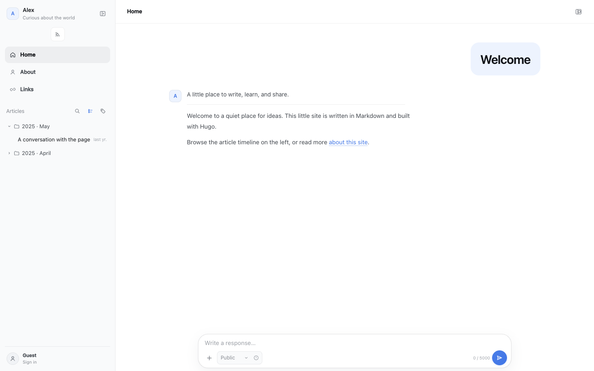

# hugo-deepseek-theme

一个受 DeepSeek Harness 交互界面启发的 Hugo 博客主题，把文章组织成一段段便于阅读的对话。
支持按年月浏览、站内搜索、文章结构视图，以及可选的 GitHub Issues 评论。

An independent, conversation-inspired Hugo blog theme with a streaming reader,
search, an article timeline, and optional GitHub Issues comments.

**在线演示 / Live demo：** [blog.dansec.vip](https://blog.dansec.vip/)



预览展示启用评论后的界面；示例站默认不连接评论服务。

**独立项目，非 DeepSeek 官方产品，也未获得 DeepSeek 赞助或背书。** 界面和交互参考了
DeepSeek Harness；第三方说明见 [THIRD_PARTY_NOTICES.md](THIRD_PARTY_NOTICES.md)。

> **名称侵权反馈：** 如认为项目或主题名称侵犯您的权益，请发送邮件至
> [d4n_for_sec@163.com](mailto:d4n_for_sec@163.com)，我们会在收到邮件后 48 小时内处理。
>
> **Naming concerns:** If you believe the project or theme name infringes your
> rights, please email [d4n_for_sec@163.com](mailto:d4n_for_sec@163.com). We will
> address the matter within 48 hours of receiving your email.

## 功能

- 文章按发布日期的年、月分组，默认展开最新月份；支持标签和本地全文搜索。
- 首页和文章采用对话式排版；文章支持流式显示和结构视图，带 `#` 的链接直接显示完整正文。
- 响应式侧边栏，适配桌面和手机；支持中英文界面。
- 可选的 GitHub Issues 评论、划线评论和评论侧栏；评论特效默认开启。
- 不依赖 Node.js 构建，静态文章在禁用 JavaScript 时仍可阅读。

## 环境要求

- Hugo Extended **0.169.0**。
- Git：用于以 submodule 安装主题。
- 评论功能可选；如需启用，还需要 Python 3.11+ 或 Docker、HTTPS 服务和 GitHub App。

## 体验示例

克隆本仓库，进入仓库目录并运行：

```sh
git clone https://github.com/d4n-sec/hugo-deepseek-theme.git
cd hugo-deepseek-theme
hugo server --source exampleSite --themesDir ../.. --theme hugo-deepseek-theme
```

打开 <http://localhost:1313/>。示例没有配置评论后端，不会访问评论服务。

## 安装

在 Hugo 站点目录中：

```sh
git init  # 如果站点还不是 Git 仓库
git submodule add https://github.com/d4n-sec/hugo-deepseek-theme.git themes/hugo-deepseek-theme
git -C themes/hugo-deepseek-theme checkout 0.0.2
```

参考 [exampleSite/hugo.toml](exampleSite/hugo.toml) 配置站点，并将其中的
`baseURL`、站点标题和作者信息改成自己的。已有站点请将配置合并进去，避免覆盖原有设置。
克隆使用本主题的站点时，使用 `git clone --recurse-submodules`，或随后执行：

```sh
git submodule update --init --recursive
```

最后运行 `hugo server -D` 本地预览，运行 `hugo` 构建。使用 GitHub Actions 时需要
在 checkout 步骤中启用 `submodules: recursive`。

## 内容目录

示例使用以下结构，可直接参考 [exampleSite/content](exampleSite/content)：

```text
content/
├── _index.md                    # 首页
├── page/                        # 特殊页面
│   ├── about/index.md           # 关于
│   └── links/index.md           # 友链
└── post/                        # 文章
    └── 2025/
        ├── 04/a-small-note.md
        └── 05/hello-world.md
```

文章可以放在 `content/post/年/月/` 下，前置数据中的 `date` 应与目录年月一致。
侧边栏按照文章的**发布日期**分组，并不从文件夹名称推断日期；Hugo 不会自动移动文件。
可以通过 `hugo new content post/2025/05/my-article.md` 创建文章，再检查日期和标题。

`content/page/` 用于关于、友链等普通独立页面，首页使用 Hugo 的 `content/_index.md`。
菜单可通过 `params.nav` 配置。示例使用 `[permalinks]` 将文章映射到 `/p/:slug/`、
特殊页映射到 `/:slug/`；也可按站点需要调整。

文章示例：

```toml
+++
title = "My article"
date = 2025-05-14T10:00:00+08:00
slug = "my-article"
comment_id = "my-article"
tags = ["notes"]
+++
```

`comment_id` 在评论功能开启时用于标识文章，建议为每篇文章设置唯一、稳定的值。
未设置时主题会从源文件路径生成 ID；移动或重命名文件会使这个自动 ID 改变。
页面前置数据设置 `comments = false` 可关闭该页面的评论。

## 文章显示模式

在站点配置中为整个博客选择一种模式，重新构建后生效：

```toml
[params.reader]
  mode = "constant" # constant | capped | instant
  typingSpeed = 18
```

- `constant`（默认）：正文、代码和表格以一致的速度逐步显示，不限制最长时间。
  默认速度约为每秒 88 个 Unicode 字符；长文章可以点击跳过动画。
- `capped`：保留原来的限时播放方式，较长的文章会在约 25.7 秒内显示完成。
- `instant`：直接显示全文，不播放动画。

`typingSpeed` 越大播放越快；`instant` 模式忽略该设置。图片和公式等内容仍会整块显示。
模式只在站点配置中设置，不提供单篇文章配置或页面内切换。带 `#` 的链接和启用系统
“减少动态效果”的访客始终直接看到全文。已有配置未设置 `mode` 时，`typing = false`
仍表示直接显示；显式设置 `mode` 优先。

## 评论服务

评论是可选功能。主题仓库内包含一个 Python 服务，它通过 GitHub OAuth 登录并使用
GitHub Issues 存储评论。部署及 GitHub App 配置请看 [server/README.md](server/README.md)，
API 约定见 [server/API.md](server/API.md)。配置完成后在站点中设置：

```toml
[params.comments]
  backendURL = "https://comments.example.com"
  repository = "owner/public-comments-repo"
  blogger = "your-github-login"
  attachments = false
```

不配置 `backendURL` 即不连接评论服务。OAuth 密钥只能放在服务器环境变量中，不能放进
Hugo 配置或公开仓库。评论及引用文字保存在 GitHub Issues 中，均为公开信息。
GitHub App 必须设为公开，其他 GitHub 用户才可授权；仓库安装范围应按需限制。

服务已使用本地 GitHub 模拟接口测试，主题作者的线上账号也曾验证登录和评论；
其他 GitHub 用户的完整登录、评论写入流程仍待独立验证。

## 验证

```sh
# 在主题仓库根目录
HUGO_BIN=hugo python3 tests/test_build.py
cd server && python3 -m unittest discover -s tests -v
```

如需在浏览器中验证播放模式，可先启动示例站，再用 `playwright-core` 和本机 Chromium
运行 `tests/test_reader.cjs`；这些工具只用于测试，不参与主题构建。

## 许可

主题及服务以 [MIT License](LICENSE) 发布，第三方许可和参考来源见
[THIRD_PARTY_NOTICES.md](THIRD_PARTY_NOTICES.md)。
